# Content Safety Decision Lab

An offline Python and SQL workflow for content-risk classification, duplicate-aware evaluation, review-capacity planning, root-cause analysis and product experiment design.

## Results

The hash-verified authors' dataset contains **24,783 posts**. The pipeline retains 24,544 unique eligible normalized texts, removes 188 duplicate rows and quarantines 51 rows from groups with conflicting labels. The deterministic split contains 14,726 training, 4,909 validation and 4,909 frozen test records.

| Frozen test measure | Result |
|---|---:|
| ROC-AUC | 0.8581 |
| PR-AUC, average precision | 0.3619 |
| Constant-score PR-AUC baseline | 0.05745 |
| PR-AUC / baseline | 6.30x |
| Posts sent to review | 360 / 4,909, 7.33% |
| Hate-speech label recall | 138 / 282, 48.94% |
| Review precision | 138 / 360, 38.33% |
| False positive rate | 222 / 4,627, 4.80% |
| False positive rate 95% Wilson interval | 4.22%–5.45% |
| Data and SQL reconciliation checks | 12 / 12 |
| Boundary tests | 6 / 6 |

**Decision: retain shadow evaluation.** The point false positive rate is below 5%, with an upper confidence bound of 5.45% and review precision of 38.33%, keeping human-in-the-loop review active before expanding automated enforcement.

## Architecture

```mermaid
flowchart LR
    A[Hash-verified annotation CSV] --> B[Normalize text and quarantine label conflicts]
    B --> C[Unique-text stratified train / validation / test]
    C --> D[Training-only TF-IDF and logistic models]
    D --> E[Validation model and threshold selection]
    E --> F[Frozen test metrics and confidence intervals]
    F --> G[SQL parity, overlapping slice diagnostics and capacity frontier]
    G --> H[Policy and operations review plus proposed launch experiment]
```



Only text enters the model. Annotation vote counts never enter its features. URLs and author mentions become placeholders. No normalized text hash crosses partitions. Missing author IDs and timestamps prevent author-independent or temporal validation. Class-weighted logistic scores are not calibrated probabilities.

## Run

```bash
python3 -m venv .venv
source .venv/bin/activate
pip install -r requirements.txt
python pipeline.py
python -m unittest discover -s tests -v
```

The pipeline downloads the pinned source automatically and rejects an unexpected SHA-256 hash. `--source /path/to/labeled_data.csv` accepts a local copy with the same hash. Local source text and SQLite data stay in ignored `data/`; only aggregate artifacts are published.

- [Executed metrics and provenance](results/metrics.json)
- [Validation model selection](results/model_selection.csv)
- [Review-capacity frontier](results/capacity_frontier.csv)
- [Descriptive error slices](results/slice_metrics.csv)
- [SQL metrics](results/sql_metrics.csv) and [CTE query](sql/metrics.sql)
- [Schema, labels, equations and backup adaptation](docs/schema-and-method.md)
- [Cross-functional launch review and experiment design](docs/launch-review.md)
- [Boundary-test output](results/unit-tests.txt)

## Product experiment design

The experiment design randomizes users and measures independently audited violating exposures per eligible user. Guardrails cover false positive actions, appeal overturns, creator retention and reviewer workload. With a 1% baseline, a 0.2 percentage point absolute reduction, 80% power and two-sided alpha .05, the independent-user planning approximation requires **35,001 users per arm**.

## Source and scope

Davidson, Warmsley, Macy and Weber, *Automated Hate Speech Detection and the Problem of Offensive Language*, ICWSM 2017. [Authors' source repository](https://github.com/t-davidson/hate-speech-and-offensive-language), pinned commit `cb50f7e9eb855a99abc51423bf40df0e26d6fe30`; source SHA-256 `fcb8bc7c68120ae4af04a5b9acd58585513ede11e1548ebf36a5c2040b6f6281`. The MIT license is provided upstream. The positive task is annotated hate speech; offensive-language posts remain negative examples. The separate [Civil Comments schema](https://huggingface.co/datasets/google/civil_comments) is documented as an alternative toxicity schema.
